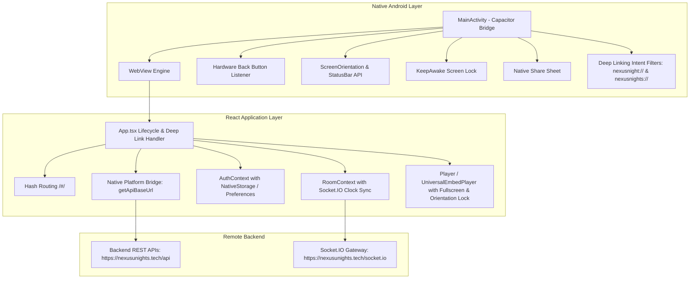

# NexusNight Android Application Design Document

## Architecture Overview

NexusNight is transformed from a web-based React watch-together platform into a native Android application using Capacitor 6.
The architecture retains 100% of the existing React codebase and build pipeline for the web browser, while adding a native Android bridge layer for mobile capabilities.

## Key Components

1. **Platform Detection & Dynamic API Base URL (`client/src/native/platform.ts`)**:
   - Web browser: returns `''` (relative paths, retaining Vite proxy and same-origin hosting).
   - Native Android: returns `https://nexusunights.tech` (or `VITE_API_URL` env variable / user-configured server URL).

2. **Storage Adapter (`nativeStorage`)**:
   - Bridges Capacitor Preferences with `window.localStorage` fallback.
   - Securely persists JWT tokens, guest session IDs, and language preference across Android application restarts.

3. **Hardware Back Button Handling (`client/src/native/back-button.ts`)**:
   - Evaluates a stack-based handler queue:
     1. Exits fullscreen video playback if active.
     2. Closes open modal dialogs (Search, Menu, CreateRoomModal, SubtitleModal).
     3. Navigates back in browser history if on detail/watch pages.
     4. Prompts with a toast on home screen before closing the app.

4. **Screen & Immersive Fullscreen (`client/src/native/screen.ts`)**:
   - Uses `@capacitor/status-bar` and `@capacitor/screen-orientation`.
   - On video fullscreen: locks orientation to landscape, hides system status and navigation bars.
   - On video exit: restores portrait orientation, unhides status bar.
   - Uses `@capacitor-community/keep-awake` to prevent display sleep during playback.

5. **Deep Linking & Discord OAuth (`client/src/native/deep-links.ts`)**:
   - Registers `nexusnight://auth/callback` and `nexusnights://` schemes in `AndroidManifest.xml`.
   - Captures OAuth tokens and deep links (`/movie/:id`, `/tv/:id`, `/room/:id`).

6. **Native Sharing (`client/src/native/share.ts`)**:
   - Uses `@capacitor/share` to trigger native Android share sheet with movie and room invitation links.
