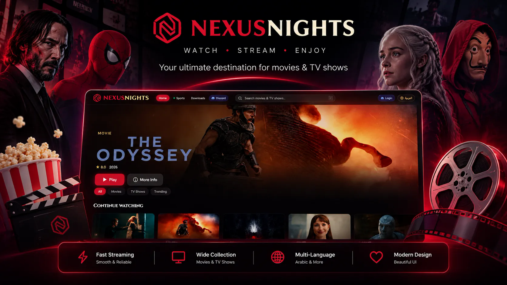

<div align="center">



# NEXUSNIGHTS

**Your Ultimate Multi-Platform Cinematic Streaming & Watch-Together Experience**

[](package.json)
[](https://react.dev/)
[](https://www.typescriptlang.org/)
[](https://nodejs.org/)
[](https://socket.io/)
[](https://tailwindcss.com/)
[](android/)
[](NexusNightsTv/)
[](LICENSE)

<p align="center">
  <b>Watch • Stream • Enjoy</b><br>
  Browse a limitless catalog powered by TMDB, stream Hollywood & Arabic cinema in 100% native HLS, watch live sports, or host synchronized Watch-Together rooms inside Discord or the browser.
</p>

[✨ Key Features](#-key-features) •
[📱 Cross-Platform](#-cross-platform-ecosystem) •
[⚡ Quick Start](#-quick-start) •
[⚙️ Configuration](#-configuration) •
[🏗️ Architecture](#️-architecture) •
[📺 TV & Mobile](#-mobile--smart-tv-apps)

---

</div>

## 🌟 Highlights

* **🎬 100% Native Player (No Embeds / No Iframes):** Custom HTML5 + HLS.js streaming engine with full controls, dynamic resolution selector (`Auto`, `1080p`, `720p`, `360p`), custom subtitles, and seamless audio synchronization.
* **👥 Synchronized Watch Together:** Real-time room synchronization via Socket.IO with authoritative server state, latency drift compensation, live chat, interactive emoji reactions, and host permissions.
* **🌍 Full Bilingual Experience (Arabic & English):** Flawless RTL / LTR layout switching, Arabic subtitles from SubDL & OpenSubtitles, and localized TMDB metadata.
* **⚽ Live Sports Streaming:** Direct HLS live channels (beIN Sports, Sky Sports) with automated server-side token management and failover.
* **📺 Multi-Platform:** Run as a Web Application, Discord Activity, native Android App (APK), or on Samsung Tizen Smart TVs (WGT).

---

## ✨ Key Features

### 🎥 Native Player & Advanced Streaming Engine
* **Direct Stream Resolution:** Headless stealth sniffers extract direct `.m3u8` streams from providers (Aether, VixSrc, Vidrift, ArabMedia / Movizland, Dizibal) in seconds.
* **Hotlink & CORS Reverse Proxy:** Proxies HLS master playlists and video segments securely while preserving upstream tokens and bypassing browser cross-origin blocks.
* **Quality Switcher:** Switch between `1080p Full HD`, `720p HD`, `360p SD`, or `Auto` bandwidth-adaptive playback.
* **Smart Failover:** Instant failover watchdog automatically switches to healthy alternative mirrors upon upstream stalls or network errors.
* **Intro & Credits Skip:** Community timestamps (IntroDB) allow single-click skipping of recaps, intros, and ending credits.

### 👥 Watch Together (Discord Activity & Web)
* **Authoritative Clock:** The server controls playhead time, media state, and playback speed; client clocks automatically nudge to eliminate drift.
* **Host Handover & Controls:** Configurable room permission modes (`Host Only`, `Host + Selected`, `Open to Everyone`).
* **In-Player Chat & Reactions:** Transparent full-screen overlay chat and emoji bursts.
* **Late-Joiner Synchronization:** New members automatically snap to the current playhead without interrupting the room.

### 🌐 Subtitles & Metadata Enrichment
* **Multi-Provider Subtitles:** Automatic search and download from OpenSubtitles, SubDL, and Wyzie Subs in 75+ languages.
* **TMDB Catalog:** Infinite scrolling, trending movies & series, genres, top-rated lists, cast details, and backdrop artwork.
* **Personalized Progress:** "Continue Watching" syncs watch time and completion percentage across devices.

---

## 📱 Cross-Platform Ecosystem

| Platform | Technology | Status | Download / Access |
|---|---|---|---|
| **Web Browser** | React 18, Vite 6, Tailwind CSS v4 | ✅ Production | Available via HTTP server |
| **Discord Activity** | Discord Embedded App SDK | ✅ Production | Runs inside Discord voice channels |
| **Android App** | Capacitor 6, Android SDK 34 | ✅ Signed Release | [NexusNight.apk](client/public/downloads/) |
| **Samsung Smart TV** | Tizen 5.0+ Web App (Strict ES5) | ✅ Signed WGT | [NexusNightTV.wgt](client/public/downloads/) |

---

## ⚡ Quick Start

### Prerequisites
* **Node.js 20+** and **npm**
* **FFmpeg** & **FFprobe** installed and accessible in system `PATH`
* **TMDB API Key** (Get free access from [TheMovieDb](https://www.themoviedb.org/settings/api))

### 1. Clone & Install
```bash
git clone https://github.com/your-username/NexusNight.git
cd NexusNight
npm install
```

### 2. Configure Environment
Create your root `.env` from the provided example:
```bash
# Windows
copy .env.example .env

# Linux / macOS
cp .env.example .env
```
Open `.env` and fill in your keys:
```env
PORT=3001
TMDB_API_KEY=your_tmdb_api_key_or_v4_token
JWT_SECRET=your_super_secret_jwt_key
ALLOW_GUEST=true
STREAMING_PROVIDERS_ENABLED=true
```

### 3. Launch Development Server
```bash
# Start backend (:3001) and frontend (:5173) concurrently
npm run dev
```

* **Web UI:** `http://localhost:5173`
* **Backend API:** `http://localhost:3001`
* **TV App Dev Server:** `cd NexusNightsTv && npm start` (runs on `:8080`)

---

## ⚙️ Configuration

The application uses a **single unified `.env` file** located at the repository root:

| Variable | Default | Purpose |
|---|---|---|
| `PORT` | `3001` | Backend HTTP & Socket.IO server port |
| `TMDB_API_KEY` | *(Required)* | TMDB API v3 key or v4 Bearer token for metadata |
| `ALLOW_GUEST` | `true` | Allows browser guest playback without requiring Discord OAuth |
| `DISCORD_CLIENT_ID` | *(Optional)* | Discord Application ID for Discord Activity mode |
| `DISCORD_CLIENT_SECRET` | *(Optional)* | Discord OAuth2 Client Secret |
| `DISCORD_REDIRECT_URI` | `http://localhost:3001/api/auth/discord/callback` | OAuth2 callback endpoint |
| `ADMIN_TOKEN` | *(Auto-generated)* | Token protecting admin endpoints and cache resets |
| `MEDIA_PATH` | `./media` | Local media storage folder |
| `DATA_PATH` | `./data` | Cache directory for subtitles, thumbnails, and state |
| `STREAMING_PROVIDERS_ENABLED`| `true` | Enables multi-source remote streaming & sniffers |
| `OPENSUBTITLES_API_KEY` | *(Optional)* | Higher rate limits for subtitle downloads |

---

## 🏗️ Architecture

```
NexusNight/
├── client/                     # Web & Discord Activity Client (React 18 + Vite)
│   ├── src/
│   │   ├── components/         # TopBar, BottomNav, Row, GlobalCard, etc.
│   │   ├── pages/              # Home, Watch, Sports, Downloads, Details
│   │   ├── player/             # NexusPlayer HTML5/HLS engine, Subtitles, Menu
│   │   ├── room/               # Realtime Watch Together lobby & sync
│   │   └── i18n.tsx            # Arabic / English localization
│   └── public/downloads/       # Distribution binaries (APK & TV WGT)
│
├── server/                     # Backend API & Streaming Orchestrator (Node.js)
│   ├── src/
│   │   ├── http/               # Express REST routes & API proxies
│   │   ├── realtime/           # Socket.IO Watch Together rooms hub
│   │   ├── streaming/          # Stream resolver, sniffers, proxies & sports
│   │   │   ├── adapters/       # Aether, VixSrc, Vidrift, ArabMedia adapters
│   │   │   ├── stream-proxy.ts # HLS manifest & segment CORS reverse proxy
│   │   │   └── stream-resolver.ts # Playwright stealth stream sniffers
│   │   └── subtitles/          # OpenSubtitles, SubDL, and Wyzie integration
│   └── scripts/                # Media seeding & server utilities
│
├── android/                    # Android Native Application (Capacitor 6)
│   ├── app/src/main/           # Android Manifest, Java main activity, res assets
│   └── build.gradle            # Gradle build configuration
│
├── NexusNightsTv/              # Samsung Tizen Smart TV Application
│   ├── js/                     # Spatial focus manager, D-Pad nav, TV player (ES5)
│   ├── css/                    # TV 10-foot UI styling (720p / 1080p / 4K)
│   ├── config.xml              # Tizen packaging manifest
│   ├── server.cjs              # TV local development & API proxy server
│   └── build.ps1               # Automated build & signing script (Samsung CLI)
│
├── scripts/                    # Android APK build and icon generator scripts
└── .env.example                # Canonical environment template
```

---

## 📺 Mobile & Smart TV Apps

### Android (APK)
Build a production-ready signed APK using the included build tool:
```bash
npm run build:android
```
The output APK will be placed in `android/app/build/outputs/apk/release/` and copied to `client/public/downloads/NexusNight.apk`.

### Samsung Smart TV (Tizen WGT)
The TV client is built with a custom spatial navigation engine designed for remote controls (D-Pad navigation) adhering to Samsung TV 10-foot guidelines:
```powershell
# From project root
cd NexusNightsTv
powershell -ExecutionPolicy Bypass -File build.ps1 -CertificateProfile "NexusNight-TV"
```
To install directly to a connected Samsung TV via Tizen SDB:
```powershell
powershell -ExecutionPolicy Bypass -File build.ps1 -CertificateProfile "NexusNight-TV" -Install
```

---

## 🔒 Security & Performance

* **Zero Leaked Credentials:** Keystores, `.p12` certificates, and `.env` secrets are strictly ignored by `.gitignore`.
* **Safe Proxies:** Media requests are routed through strict reverse proxies with custom user agents and referer headers, preventing hotlinking restrictions while shielding clients.
* **Zod Schema Validation:** All socket payloads, API parameters, and environment keys are strictly validated before execution.
* **Auto Cache Eviction:** Stream tokens that expire upstream are automatically evicted from server memory to prevent playback freezes.

---

## 📜 Disclaimer

NexusNights is built for personal, educational, and home-media usage. It does not host or store copyrighted videos on its servers. Users are responsible for complying with the terms of service of any third-party APIs or content sources utilized.

---

<div align="center">
  <sub>Crafted with passion for cinema & seamless streaming.</sub>
</div>
